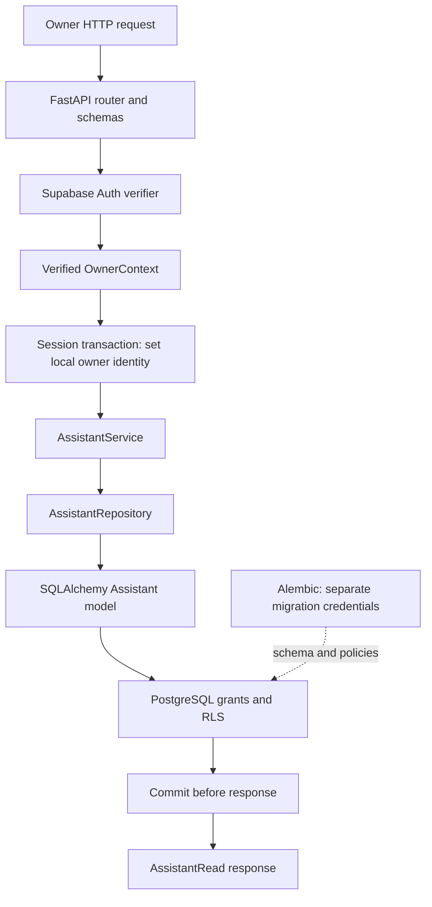

# Phase 1 Explained — Owner-scoped assistants

## إغلاق Phase 1 بعد التحقق الفعلي — 2026-10-11

**اكتملت Phase 1 ضمن نطاق backend المعتمد.** شغّلت المطوّرة أداة
`backend/scripts/signin_phase1.py` بحسابَي Supabase Auth حقيقيين، وطابقنا مخرجاتها
مع `docs/ai-sdlc/contracts/PHASE-1-LIVE-RESULTS.json`: نجحت **9 مجموعات تحقق حي**
دون تخطي، ونسخة Alembic هي `0002_assistant_owner_rls`. حُذفت سجلات الاختبار
الثلاثة المحددة فقط، ولم تبقَ سجلات اختبار. الحالات المعلّقة أدناه سجل تاريخي
تتجاوزه هذه النتيجة.

الأداة تقرأ البريد بشكل ظاهر وكلمة المرور بشكل مخفي؛ تستخدم إعدادات Auth
الموجودة وتحفظ التوكنات في الذاكرة فقط. تمر طلبات الاختبار عبر FastAPI وSupabase
Auth الحقيقيين، ثم service وrepository وSQLAlchemy وصولًا إلى PostgreSQL بدور
`assistant_runtime`. لا توجد مصادقة بديلة في هذا المسار. أثبتت القراءة بعد
التعديل حفظ الإعدادات، واستقلال المساعدين، وإخفاء مساعد المالك الآخر بـ404.

التنظيف إجراء اختبار إداري منفصل، وليس endpoint جديدًا: يتحقق من ID والمالك
وعلامة التشغيل وحالة draft قبل الحذف في معاملة واحدة، ويرفض dependencies غير
متوقعة أو عدد حذف غير مطابق. صلاحية DELETE ما زالت ممنوعة على التطبيق، وRLS
لم يُعطّل. إذا فشل التحقق تحتفظ الأداة بالسجلات للمراجعة.

الاختبارات المحلية: **46 passed و12 skipped** لقاعدة PostgreSQL محلية مخصصة؛
لا نعدّها اختبارات ناجحة. اختبارات Supabase الحية دليل منفصل. ما زال تحذيرا
deprecation في أدوات الاختبار، دون فشل. يشمل الإغلاق AC-001 وAC-002 وجزء
الإعدادات الأساسية من AC-003 وجزء API من AC-018؛ الملفات والواجهات وباقي
workflows ليست منفّذة هنا. تبقى FastAPI حد الثقة: custom session variable لا
يحمي من تنفيذ SQL اعتباطي تحت نفس الدور.

راجعي شرح الملفات والأسئلة الخمسة والتمرين أدناه قبل Phase 2. لم تبدأ Phase 2.

## نتيجة إعادة التحقق قبل الإغلاق — 2026-10-11

أُعيد تشغيل مجموعة الاختبارات المحلية: **36 passed، و12 skipped**؛ الاختبارات
المتخطاة تحتاج PostgreSQL محليًا مخصصًا. ظهر تحذيران deprecation من Starlette
وAlembic، ولم يفشل اختبار محلي. نجحت **7 مجموعات تحقق حي** على Supabase بعد
إعادة المحاولة بصلاحية الشبكة؛ بقيت نسخة Alembic `0002_assistant_owner_rls`.

لم يعمل اختبار API بحسابَي Supabase موثّقين لأن توكناتهما غير متوفرة محليًا.
الفرق التعليمي مهم: اختبار SQL بهويتين UUID يثبت تطبيق RLS، واختبار endpoint
بمصادقة بديلة يثبت سلوك التطبيق، لكن جمع النتيجتين لا يثبت مسار المصادقة الحقيقي
حتى PostgreSQL. لذلك تظل Phase 1 معلّقة القبول، ولا يوجد commit أو push جديد
لهذا الإغلاق، ولا تبدأ Phase 2 بعد.

لم نغيّر architecture أو التطبيق أو قاعدة البيانات في إعادة التحقق هذه.
نتائجها موثّقة في `docs/ai-sdlc/contracts/PHASE-1-LIVE-RESULTS.json` وفي تقرير
النشر. يبقى الشرح والأسئلة الخمسة والتمرين أدناه للمراجعة، مع هذه الحالة الأحدث.

## تحديث التحقق الحي — 2026-10-11

هذا الملحق يحدّث الحالة؛ الشرح المؤرخ 2026-10-10 أدناه محفوظ كسجل للمراجعة السابقة.

**تم نشر أساس أمان قاعدة البيانات والتحقق منه على Supabase. قبول Phase 1 الكامل
ما زال معلّقًا على اختبار API بحسابين موثّقين فعليًا.** لا توجد أي تغييرات Phase 2.

### ما نُفّذ فعلًا

بعد مطابقة تعريف public.rls_auto_enable حرفيًا والتحقق من مالكها postgres وكونها
SECURITY DEFINER وsearch_path=pg_catalog، تحقق السكربت من ensure_rls وحالته وأحداثه.
هذه الدالة تعمل كـevent trigger وتفعّل RLS فقط للجداول المنشأة في public؛ لا تمنح
صلاحيات أو تعطّل RLS، وتستخدم identifiers مقتبسة. لم نغيّر الدالة أو الـtrigger.
نجاح الترحيلات الفعلي أثبت عدم تعارضهما مع Alembic في هذا النشر، دون اعتبار ذلك
إعفاءً عامًا لأي دالة جديدة أو تغيير مستقبلي.

أُنشئ assistant_runtime، وطُبّق 0001 ثم 0002 ضمن معاملة نشر واحدة، وأُثبتت النسخة
0002_assistant_owner_rls باستعلام حي. تم حفظ DATABASE_URL بالدور المحدود في .env
المستثنى من Git، بينما بقي اتصال الترحيلات مستقلًا. لم تُعرض كلمات المرور.

| الملف الجديد/المحدّث | دوره في النشر والتحقق |
| --- | --- |
| `backend/scripts/phase1_baseline.py` | مقارنة تعريف الدالة وإعداداتها والـtrigger بالقيم المعتمدة؛ رفض تغيرها أو وجود دوال public إضافية غير تابعة لإضافات PostgreSQL. |
| `backend/scripts/deploy_phase1.py` | نشر أولي مشروط بقاعدة بلا جداول تطبيق؛ إنشاء الدور مع SCRAM verifier مولّد، وتشغيل الترحيلات بالاتصال نفسه. ليس أداة إعادة تشغيل تلقائي على قاعدة منشورة. |
| `backend/alembic/env.py` | يقبل connection داخليًا من أداة النشر حتى يشترك إنشاء الدور والترحيلات في المعاملة نفسها. |
| `backend/scripts/verify_phase1_live.py` | فحوصات قراءة وصلاحيات واختبارات runtime بمعاملات تتراجع؛ لا migrations أو TRUNCATE أو تعطيل RLS أو حذف إداري. |
| `backend/tests/test_deployment_baseline.py` | يثبت قبول التعريف المحدد ورفض تغير المالك والجسم وsearch_path وSECURITY DEFINER والأحداث والحالة وإضافة دالة. |
| `docs/ai-sdlc/contracts/PHASE-1-LIVE-RESULTS.json` | نتيجة فعلية مختصرة لا تحتوي credentials؛ توضح النجاح والتخطي. |

### ماذا يعني الدور المحدود عمليًا؟

اتصل الاختبار ببيانات assistant_runtime فعلًا، وليس باتصال postgres مع محاكاة الاسم.
اجتاز فحص صفات الدور والعضويات وملكية الجدول ومنع CREATE على public. يستطيع
SELECT وINSERT تحت RLS، ويستطيع UPDATE فقط على name وrole وcolors وresponse_style
وtone وfallback_message وupdated_at. owner_id وid وstate وcreated_at ليست قابلة
للتعديل بهذا الدور. DELETE وTRUNCATE وREFERENCES وTRIGGER غير ممنوحة.

تأكدنا من غياب grants على مستوى الجدول والأعمدة لـanon وauthenticated وservice_role
على assistants وalembic_version. هذا وصف لهذه الجداول والـgrants المفحوصة، وليس
ادعاء أن جميع مسارات Supabase والمخططات الأخرى خضعت لتدقيق أمني شامل.

### النتائج الفعلية وحدودها

نجحت سبع مجموعات تحقق حية:

1. نسخة Alembic وتعريف الـtrigger المعتمد لم يتغيرا.
2. RLS على assistants مفعّلة ومفروضة، ولا توجد grants غير مقصودة لمسار Data API.
3. الدخول الفعلي بالدور المحدود وقائمة أعمدة UPDATE الدقيقة.
4. مالكان بـUUIDs منفصلين لا يريان سجلات بعضهما حتى في SELECT بلا فلتر مالك؛ UPDATE عبر المالك يعيد صفر سجلات.
5. رفض تغيير owner_id وDELETE لسجل اختبار، وINSERT بمالك مخالف، مع التحقق من SQLSTATE المتوقع.
6. الهوية الفارغة لا تُظهر سجلات ولا تسمح بالإدخال؛ الهوية غير الصالحة تُرفض.
7. rollback أزال السجلات التجريبية جميعها، ولم تنتقل الهوية إلى معاملة جديدة بعد rollback أو commit على pool بحجم اتصال واحد.

هذه UUIDs تجريبية لا تمثل تسجيل دخول Supabase Auth فعليًا. هدفها إثبات سياسة قاعدة
البيانات تحت حدود الثقة المعتمدة. اختبار الحسابين الحقيقيين تخطّاه سكربت التحقق
لعدم توفر PHASE1_OWNER_A_TOKEN وPHASE1_OWNER_B_TOKEN؛ لم تُنشأ حسابات ولم يُزوّر
توكن ولم يُستخدم تجاوز للمصادقة. لم تبقَ أي سجلات تحقق محفوظة.

الاختبارات المحلية: 28 اختبارًا نجحت في التشغيل الكامل، و12 اختبار PostgreSQL
المحلية متخطّاة. ثم نجحت 8 اختبارات إضافية لتعريف baseline؛ المجموع 36 اختبارًا
محليًا ناجحًا عبر التشغيلين. مجموعات التحقق الحي السبع مستقلة عن عدّاد pytest.
التحذيران يتعلقان بـTestClient/httpx وإعداد path_separator في Alembic، لا بفشل RLS.

### ما الذي يبقى قبل إغلاق المرحلة؟

يلزم مالكان حقيقيان موثّقان لإكمال اختبار HTTP من التوكن إلى قاعدة البيانات، وإنشاء
مساعدين للمالك الأول ومساعد للثاني، ثم حفظ كل إعداد وإعادة قراءته عبر معاملة جديدة.
السكربت يدعم ذلك عند توفير التوكنات محليًا؛ عند تشغيل هذا الفرع يحتفظ بالسجلات
الجديدة للمراجعة بدل تنفيذ تنظيف حذف على قاعدة حية. لا نحتاج مشاركة التوكنات في
المحادثة أو إضافة server key إلى المتصفح.

أصبحت أدلة AC-002 على مستوى PostgreSQL فعلية؛ تبقى المصادقة الحية وAC-001 وقراءة
كل إعداد في AC-003 غير مغلقة نهايةً إلى نهاية. معرفة الملفات خارج نطاق هذه المرحلة.
لا نغيّر تفسير custom session variable: من يستطيع SQL اعتباطيًا تحت runtime role
يستطيع تغيير الهوية؛ تظل FastAPI هي الجهة الموثوقة للمصادقة.

راجع الأسئلة الخمسة والتمرين في القسم 9 أدناه، ثم أجب أيضًا: لماذا لا تسمح لنا
نتيجة عزل UUIDs في SQL أن نقول إن تسجيل الدخول بحسابين حقيقيين قد اختُبر؟

## التقرير التعليمي السابق — 2026-10-10

تاريخ المراجعة: 2026-10-10

حالة التقرير: مراجعة تعليمية للتنفيذ المحلي؛ Phase 1 غير مغلقة بسبب التحقق المعلّق على PostgreSQL.

## 1. أين وصلنا فعلًا؟

الهدف من Phase 1 أن يستطيع مالك موثّق إنشاء مساعد وعرض مساعديه وتعديل إعداداتهم بشكل مستقل. هذه المرحلة تبني أساس المنتج قبل رفع المعرفة أو توليد الإجابات.

الكود الحالي يحتوي أربعة endpoints: `POST /assistants` و`GET /assistants` و`GET /assistants/{assistant_id}` و`PATCH /assistants/{assistant_id}`. يخزن إعدادات المساعد بحالة `draft`. لا توجد بعد snapshots منشورة أو ملفات معرفة أو playground أو RAG أو widget أو محادثات زوار. وجود قيمة draft لا يعني أن دورة draft/published كاملة أصبحت منفذة.

ADR-001 حالته accepted: هذا اعتماد للقرار المعماري، لا دليل أن قاعدة البيانات الحية أصبحت مطابقة له. ترحيلات الجدول وRLS موجودة محليًا، لكن آخر محاولة نشر توقفت عند DNS قبل أي تغيير حي. لم نعد محاولة الاتصال ضمن هذه المراجعة التعليمية. نجاح SELECT 1 الذي أبلغ عنه المطور سابقًا يثبت اتصالًا في تلك اللحظة فقط؛ لا يثبت صلاحيات الدور أو RLS أو تطبيق الترحيلات.

كما أن ADR-001 أوسع من Phase 1: pgvector وبيانات المعرفة والمحادثات تتعلق بمراحل لاحقة، فلا نصف كامل القرار بأنه «تم تنفيذه» الآن.

المراجع: [Intent](../../intent/ai-assistant-builder.md)، [SPEC-001](../ai-sdlc/specs/SPEC-001.md)، [PLAN-001](../ai-sdlc/plans/PLAN-001.md)، [ADR-001](../ai-sdlc/adr/ADR-001.md)، [ADR-002](../ai-sdlc/adr/ADR-002.md).

## 2. العلاقة بين الطبقات



المخطط يصف مسار التشغيل المقصود في الكود؛ جزء PostgreSQL وRLS لم يثبت باختبار تكاملي ناجح بعد. ترتيب المصادقة والتحقق من body تديره dependencies في FastAPI، وليس سلسلة استدعاءات يدوية داخل route.

Router يعرف HTTP، والخدمة تعرف حالة الاستخدام، وrepository يعرف الاستعلامات. حاليًا بعض دوال الخدمة مجرد تمرير للطلبات؛ هذا طبيعي لبداية صغيرة، لكنه ليس دليل وجود domain framework معقد. مخططات Pydantic تستخدم أيضًا كمدخل للخدمة وrepository، أي أن الفصل الحالي عملي وخفيف وليس عزلًا كاملًا لكل أنواع البيانات.

## 3. جولة على الملفات

المسارات أدناه من جذر المستودع، والروابط تقود إلى الملفات نفسها.

| الملف | المسؤولية والمدخلات والمخرجات |
| --- | --- |
| [backend/src/assistant_builder/main.py](../../backend/src/assistant_builder/main.py) | `create_app()` يسجل router. `lifespan` ينشئ Engine ومصنع الجلسات مرة واحدة، يفحص دور التشغيل، ويحرر Engine وHTTP client عند الإغلاق. لا ينشئ جداول. |
| [backend/src/assistant_builder/config.py](../../backend/src/assistant_builder/config.py) | `Settings` يقرأ إعدادات التشغيل، و`get_settings()` يخزنها مؤقتًا. `MigrationSettings` يطلب MIGRATION_DATABASE_URL بصورة مستقلة؛ لا fallback بين الاتصالين. تعديلات البيئة تحتاج إعادة تحميل الإعدادات أو إعادة التشغيل. |
| [backend/src/assistant_builder/auth.py](../../backend/src/assistant_builder/auth.py) | `SupabaseAuthVerifier.verify()` يستقبل Authorization ويتحقق عبر `/auth/v1/user` ثم ينتج `OwnerContext(UUID)`. `get_current_owner()` يحول حالات الرفض إلى 401 وحالات تعطل خدمة التحقق إلى 503. |
| [backend/src/assistant_builder/db.py](../../backend/src/assistant_builder/db.py) | `create_database_engine()` يستخدم اتصال التشغيل. `validate_runtime_role()` يفحص صلاحيات الدور من catalogs. `set_owner_identity()` يربط UUID بالمعاملة. `get_db_session()` يوفر Session واحدة بعد المصادقة ويملك commit/rollback. |
| [backend/src/assistant_builder/api.py](../../backend/src/assistant_builder/api.py) | يربط HTTP بالخدمة وschemas. `get_assistant_service()` يبني الخدمة وrepository حول Session الطلب. missing/cross-owner assistant يعيد 404. |
| [backend/src/assistant_builder/schemas.py](../../backend/src/assistant_builder/schemas.py) | `AssistantCreate` للتحقق من الإنشاء، `AssistantUpdate` للتعديل الجزئي، `AssistantRead` للاستجابة من ORM attributes. `extra='forbid'` يمنع حقولًا مثل owner_id في المدخلات. |
| [backend/src/assistant_builder/services.py](../../backend/src/assistant_builder/services.py) | `AssistantService.create/list/get/update` تستقبل owner UUID. `get()` يستخدم lookup مقيّدًا بالمالك ويرفع `AssistantNotFound`. `update()` لا يعدّل سجلًا قبل المرور بهذا الفحص. |
| [backend/src/assistant_builder/repositories.py](../../backend/src/assistant_builder/repositories.py) | `create()` يبني ORM object ويعمل flush. `list_for_owner/get_for_owner` يضيفان شرط المالك. `update()` يعدّل الحقول المرسلة فقط؛ يعتمد على الخدمة لجلب سجل مصرح به. |
| [backend/src/assistant_builder/models.py](../../backend/src/assistant_builder/models.py) | `Assistant` يعرّف جدول assistants: UUID ومعرّف المالك والإعدادات وdraft والتوقيتات وفهرس owner_id. `Base` يجمع metadata. |
| [backend/alembic/env.py](../../backend/alembic/env.py) | يقرأ اتصال الترحيلات وحده، ويربط Base.metadata بـAlembic. online ينفذ على قاعدة؛ offline يولد SQL فقط. |
| [backend/alembic/versions/0001_create_assistants.py](../../backend/alembic/versions/0001_create_assistants.py) | إنشاء الجدول والفهرس. يصف تغيير schema، لا ينفذ تلقائيًا عند import التطبيق. |
| [backend/alembic/versions/0002_assistant_owner_rls.py](../../backend/alembic/versions/0002_assistant_owner_rls.py) | يفترض وجود دور التشغيل، يرفض سياسات سابقة تحتاج مراجعة، يسحب grants، يحدد أعمدة UPDATE، ويفعّل ويفرض RLS. downgrade متوقف عمدًا لأنه قد يعيد وصولًا غير محمي. |
| [backend/scripts/provision_runtime_role.sql](../../backend/scripts/provision_runtime_role.sql) | إعداد إداري منفصل للدور وCONNECT؛ بلا كلمة مرور. وجود السكربت لا يعني أنه نُفّذ. |

ملفات المساندة: `backend/pyproject.toml` يحدد dependencies والحد الأدنى لـFastAPI، و`backend/uv.lock` يثبت النسخ. `backend/alembic.ini` إعداد Alembic و`backend/alembic/script.py.mako` قالب ترحيل. `backend/.env.example` أسماء الإعدادات وأمثلة بلا أسرار، و`backend/.gitignore` يستبعد الملفات المحلية. ملفات `__init__.py` تعرّف packages ولا تنفذ حالات استخدام.

## 4. تتبع إنشاء مساعد خطوة بخطوة

تخيّل أن المالك A يرسل إعدادات مساعد «Customer Support».

1. يستقبل `POST /assistants` body يحتوي الاسم والدور والألوان ونمط الرد والنبرة ورسالة fallback. لا يرسل A owner_id.
2. Pydantic يراجع شكل البيانات والحقول الإضافية. المصادقة تستخرج UUID من نتيجة التحقق في Supabase، لا من ادعاء المستخدم.
3. تعتمد `get_db_session` مباشرة على `get_current_owner`؛ عند غياب المصادقة لا يبدأ مسار بيانات المالك.
4. `session_factory.begin()` ينشئ Session ومعاملة. قبل تسليم Session للخدمة، تنفذ `set_owner_identity` أمرًا ذا bound parameter لتعيين app.owner_id محليًا للمعاملة.
5. `AssistantService.create()` يمرر المالك والبيانات إلى repository. ينشئ repository `Assistant` ويعمل `session.add()` ثم `flush()`، فيتوفر UUID وتوقيت الإنشاء من عملية الإدخال.
6. عند تنفيذ INSERT يفترض أن صلاحيات PostgreSQL وWITH CHECK تطابق owner_id مع هوية المعاملة. هذا الجزء يحتاج إثباتًا فعليًا على PostgreSQL.
7. تنتج الاستجابة من `AssistantRead`. لأن dependency لها `scope='function'`، تنتهي المعاملة قبل إرسال الاستجابة. فشل commit يمنع نجاحًا كاذبًا.
8. تغلق Session. يبقى Engine جاهزًا للطلبات التالية، ولا تبقى هوية هذا الطلب كإعداد دائم للاتصال.

### لماذا flush لا يكفي؟

`flush()` يرسل التغييرات داخل المعاملة؛ `commit()` يثبتها. قبل التصحيح كان repository يعمل flush دون حد نجاح واضح للـcommit، وقد يعيد API نتيجة بينما لا يبقى السجل بعد إغلاق الجلسة. الآن حد المعاملة في dependency، وليس في كل repository method، حتى تكون عمليات الطلب وحدة واحدة قابلة للتراجع.

### لماذا PATCH يفرق بين omitted وnull؟

`{"tone":"formal"}` يغير النبرة فقط. `exclude_unset=True` يمنع الكتابة فوق الحقول التي لم يرسلها المستخدم. أما `{"name":null}` فيرفضه validator لأن الاسم مطلوب في قاعدة البيانات. غياب الحقل لا يساوي طلب مسحه.

## 5. الأمان والقرارات الهندسية

**Authentication مقابل Authorization:** Supabase يثبت هوية المستخدم؛ الخدمة وrepository وRLS يحددان السجلات المسموح بها. UUID عشوائي يصعّب التخمين لكنه ليس تصريح وصول.

**Engine مقابل Session:** Engine ومجموعة الاتصالات موارد طويلة العمر. Session تمثل العمل الخاص بطلب واحد ولا تُشارك بين الطلبات. إعادة إنشاء Engine لكل طلب كانت تهدر إدارة الاتصالات؛ مشاركة Session واحدة بين الجميع كانت ستخلط المعاملات والهويات.

**SQLAlchemy وAlembic:** ORM يقلل التعامل اليدوي مع SQL في حالات الاستخدام، وAlembic يجعل تغييرات schema قابلة للمراجعة والتتبع. اختبارات SQLite أسرع لتجربة دورة المعاملة، لكنها لا تختبر سياسات PostgreSQL أو grants أو pooler الخاص بـSupabase.

**اتصالان:** MIGRATION_DATABASE_URL للعمل الإداري وDATABASE_URL للدور المحدود. بقاء إعدادات host/user/password القديمة لا يجعل التطبيق يستخدمها بعد إزالة fallback. لا تُرسل بيانات الترحيلات إلى عملية FastAPI المنشورة.

**RLS:** التعبير في 0002 هو `owner_id = NULLIF(current_setting('app.owner_id', true), '')::uuid`. غياب القيمة أو فراغها ينتج NULL، فلا يسمح الشرط بسجلات. قيمة غير صالحة تفشل بدل منح وصول. UPDATE له USING للسجل الحالي وWITH CHECK للنتيجة، وفوق ذلك لا توجد صلاحية تعديل عمود owner_id.

**حد الثقة:** `set_config(..., true)` محلي للمعاملة. قاعدة البيانات تثق في FastAPI الذي سبق أن تحقق من المستخدم. من يستطيع تنفيذ SQL اعتباطي ببيانات دور التشغيل يستطيع تغيير app.owner_id؛ المتغير ليس توقيعًا أو مصادقة مستقلة. لا ندّعي حماية من اختراق runtime credential.

**الفحص عند startup:** يفحص اسم الدور وصفاته وعضوياته وبعض grants وحالة RLS. لكنه ليس اختبارًا كاملًا لصحة جميع السياسات أو RPCs/views الحية. قد تكون RLS مفعلة مع سياسة خاطئة؛ لهذا نحتاج اختبارات سلوكية.

**Trade-off:** تمرير هوية موثقة من FastAPI هو الخيار البسيط المعتمد للـMVP. JWT verification داخل PostgreSQL يزيد التعقيد وإدارة المفاتيح، والانتقال إلى Data API يغير مسار persistence المعتمد. لم نطبّق أيًا منهما.

## 6. نتائج الاختبارات وحدودها

أعيد تشغيل الاختبارات خلال هذه المراجعة من backend:

```powershell
$env:PHASE1_LOCAL_PG_TESTS='0'
.venv/Scripts/python.exe -m pytest -q -p no:cacheprovider
```

النتيجة الفعلية: **27 passed, 12 skipped, 1 warning**. التحذير StarletteDeprecationWarning متعلق باستخدام TestClient مع httpx. لم نضف dependency لمعالجته ضمن شرح المرحلة.

تم تعطيل opt-in لاختبارات PostgreSQL عمدًا لهذا التقرير التعليمي حتى لا يتحول إلى مهمة نشر أو تعديل قاعدة. آخر عائق نشر معروف هو DNS في اتصال الترحيلات؛ لم نتحقق اليوم من استمرار العائق أو تغيّره.

| ملف الاختبار | ما يثبته وما لا يثبته |
| --- | --- |
| `backend/tests/test_phase1_contracts.py` | إنشاء draft، listing/update ضمن المالك، رفض owner_id من العميل، رفض المصادقة المفقودة، verifier باستخدام MockTransport. يستخدم fake repository؛ لا يثبت حفظ PostgreSQL. |
| `backend/tests/test_phase1_hardening.py` | رفض null لكل حقل، تصنيف أخطاء المصادقة، timeout، حفظ وتراجع بجلسة SQLite، lifecycle للـEngine. اختبار SQLite يعطل set_owner_identity صراحة ولا يختبر RLS. |
| `backend/tests/test_database_config.py` | عدم fallback بين الاتصالين وإخفاء URLs من repr. لا يختبر صحة credentials أو الشبكة. |
| `backend/tests/test_owner_transaction.py` | ضبط الهوية قبل yield، رفض هوية غير UUID، غياب المصادقة يمنع فتح Session. بعض ذلك mock-based، فلا يثبت reset داخل PostgreSQL. |
| `backend/tests/test_postgresql_phase1.py` | 12 حالة معدّة للعزل المباشر وغياب/فساد الهوية والصلاحيات وrollback وإعادة استخدام الاتصال وData API grants. جميعها متخطّاة في هذه المراجعة، وليست ناجحة. |
| `backend/tests/conftest.py` | يعزل إعدادات الاختبارات العادية عن credentials التطوير ويعيد ضبط cache. |

الـPostgreSQL suite الحالي يقبل loopback وقاعدة `assistant_builder_phase1_test` فقط، ويطبّق migrations في opt-in وينظف سجلات مالكين عشوائيين. لا يصلح تشغيله كما هو على Supabase الحي. طلب المطور النشر على المشروع الموجود يحتاج مسار تحقق حي غير هدّام ومراجعة preflight؛ لا نزيل قيد الاختبار المحلي فقط لجعله يمر.

## 7. مراجعة Acceptance Criteria

| المرجع | التقييم الحالي |
| --- | --- |
| FR-001 / AC-001 | الإنشاء والlisting والإدارة موجودة؛ الاختبارات الحالية لا تثبت سيناريو إنشاء مساعدَين لنفس المالك عبر API كاملًا على PostgreSQL. التغطية جزئية. |
| FR-001 / AC-002 | عزل الخدمة مثبت ضمن fakes وبعض شروط dependency. عزل قاعدة البيانات غير متحقق فعليًا بعد؛ لا نغلق المعيار. |
| FR-002 / AC-003 | حقول إعداد المساعد موجودة مع تحقق null وحفظ اختباري لبعض القيم؛ لا اختبار شامل لإعادة قراءة كل الحقول على PostgreSQL. knowledge-file association مؤجلة خارج Phase 1. |
| NFR-001 | لا يوجد UI أو اختبار قابلية استخدام مع صاحب عمل؛ backend وحده لا يثبت سهولة الاستخدام. |
| NFR-002 / AC-018 | schemas للعمليات المنفذة لا تطلب model parameters أو code. المعايير المتعلقة بكل workflows لا تكتمل قبل تنفيذ المراحل اللاحقة. |
| FR-010 / AC-015–016 | draft field موجود، لكن snapshots والنشر خارج هذه المرحلة؛ لم يتم إثبات الفصل العام/الخاص بعد. |

تحتاج PLAN-001 لاحقًا مزامنة الفقرات القديمة عن «ADR candidates» والتقنيات غير المختارة مع ADRs المقبولة. جملة أن draft status عائق قديمة أيضًا؛ المطور أجاز صراحة بقاء SPEC/PLAN في draft أثناء التنفيذ. لم أعدل هذه الوثائق خلال التقرير.

## 8. كيف نحقق في الأعطال؟

| العرض | أول ما نفحصه |
| --- | --- |
| الإعداد موجود لكن الاتصال يفشل | bool(host) ليس اختبار اتصال. افحص المصدر الفعلي للإعداد؛ ثم DNS والشبكة قبل كلمة المرور. لا تطبع URL أو exception قد تكشف أسرارًا. |
| `label empty` | قد يكون URL تجريبيًا مثل host من نقاط، كما حدث في السجل السابق. |
| `getaddrinfo failed` | فشل حل اسم الخادم قبل المصادقة؛ راجع عنوان Connect وطريقة الاتصال. لا تفترض أن RLS سبب المشكلة. |
| 401 | ترويسة مفقودة أو توكن مرفوض. راجع مسار المصادقة لا صلاحيات جدول assistants أولًا. |
| 503 من المصادقة | خدمة تحقق غير متاحة أو إعداد ناقص أو استجابة غير متوقعة؛ لا تطلب من المستخدم تغيير كلمة مروره تلقائيًا. |
| Startup يرفض runtime role | افحص الدور الحقيقي وRLS وgrants. لا تتجاوز الفحص باستعمال postgres. |
| قراءة فارغة | تحقق من هوية المعاملة ووجود البيانات والسياسة؛ القراءة الفارغة قد تكون fail-closed صحيحًا. |
| تعديل يرجع خطأ صلاحيات | افحص أعمدة UPDATE المطلوبة بما فيها updated_at؛ لا تمنح UPDATE عامًا لتجاوز الاختبار. |
| لا يبقى السجل بعد استجابة | افحص commit boundary واختبر القراءة بجلسة جديدة؛ fake repository لا يكشف هذه المشكلة. |

قراءة traceback تبدأ من آخر سبب مفيد، ثم نعود إلى استدعائنا الذي سببه، بدل افتراض أن كل الإطارات مشكلة مستقلة.

## 9. Knowledge check — أجب قبل رؤية الحلول

1. ما الفرق بين `AssistantCreate` وORM model `Assistant`؟ لماذا لا يقبل الأول owner_id؟
2. لماذا يعمل repository بـflush بينما تملك dependency الـcommit؟ ماذا يحدث إذا فشل commit؟
3. إذا كتب مبرمج SELECT دون شرط owner_id، متى يستطيع RLS حمايتنا ومتى لا يستطيع؟
4. لماذا لا يثبت اختبار SQLite أو mock لـset_config أن هوية المالك لن تتسرب عند إعادة استخدام PostgreSQL connection؟
5. شخص يملك بيانات اتصال assistant_runtime وينفذ SQL اعتباطيًا: أي افتراض في التصميم لم يعد صالحًا؟ ولماذا لا يحل FORCE RLS هذه المشكلة وحده؟

تمرين عملي: صمّم اختبارًا تكامليًا يستخدم اتصالًا معاد الاستخدام. تبدأ معاملة للمالك A، تعدّل بياناته ثم تثير استثناءً. تبدأ بعدها معاملة بلا هوية، ثم معاملة للمالك B. اكتب assertions التي تثبت rollback، غياب الهوية القديمة، وعزل B. حدّد ما يجب تنفيذه على PostgreSQL وما يجوز محاكاته، ولا تنفذ التمرين على بيانات حية.

لا توجد حلول هنا قبل محاولة المطور.

## 10. بوابة الانتقال

ينبغي أن تستطيع الآن تتبع الطلب، تفسير Engine/Session/transaction، التمييز بين المصادقة والملكية، ومعرفة الفرق بين ADR accepted واختبار ناجح وإعداد حي مُثبت.

المعلّق تقنيًا: preflight اتصال الترحيلات، إنشاء الدور وتطبيق الترحيلات وفق شروط النشر المصرح بها، إثبات العزل الحقيقي، وسد فجوات سيناريوهات AC-001/003. لا يعني انتهاء التقرير أن Phase 1 اكتملت.

ننتظر مراجعة المطور لهذا التقرير قبل بدء المرحلة التالية، وفق AGENTS.md. لم يُعدّل كود التطبيق أو أسرار أو قاعدة بيانات أو إعداد نشر خلال هذه المراجعة.
