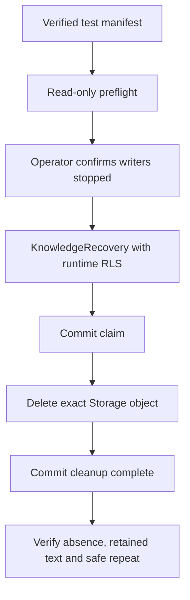

# Phase 2 — Knowledge Upload & Management

تاريخ المراجعة الأصلية: 2026-10-12. تحديث التحقق: 2026-10-14؛ انظر الملحق الأخير.

**الحالة الحالية: Phase 2 مكتملة بعد موافقتك والمراجعة النهائية في 2026-10-14. لم تبدأ Phase 3.**
هذا التقرير يشرح التنفيذ الحالي، ولا يعتبر إنشاء الكود دليلًا على اكتمال المرحلة.
لا يتضمن embeddings أو RAG أو publishing. لم يُعدَّل تقرير Phase 1.

## 1. ما الذي أنجزناه ولماذا؟

أصبح لدى المالك مسار لرفع PDF/DOCX، استخراج النص، حفظ الملف في private Supabase
Storage، وعرض المرفقات أو إزالة ارتباطها بالمسودة. الإضافة الحالية هي إصدار رابط
لتنزيل الملف الأصلي بعد التحقق من ملكية الملف، بمدة افتراضية 60 ثانية.

هذا يخدم FR-003 وAC-005 الخاصين بإدارة الملفات والوصول إليها، ويستخدم عزل المالك
المطلوب في FR-001 وAC-002. المدة القصيرة وStorage adapter الخادمي من ADR-002/003؛
ليسا متطلبات جديدة للمنتج. لا نحتاج migration أو dependency أو Storage policy جديدة.

المراجع: [Intent](../../intent/ai-assistant-builder.md)،
[SPEC-001](../ai-sdlc/specs/SPEC-001.md)، [PLAN-001](../ai-sdlc/plans/PLAN-001.md)،
[ADR-001](../ai-sdlc/adr/ADR-001.md)، [ADR-002](../ai-sdlc/adr/ADR-002.md)،
[ADR-003](../ai-sdlc/adr/ADR-003.md).

## 2. الفكرة المعمارية

الـbucket يبقى private. المالك لا يحصل على Storage secret. بدلًا من ذلك يطلب من
FastAPI إذنًا مؤقتًا لتنزيل **ملف معيّن**. التطبيق يثبت الملكية من قاعدة البيانات ثم
يطلب من Storage توقيع رابط لذلك الملف، ويعيد الرابط المؤقت إلى المالك.

```mermaid
sequenceDiagram
    participant Owner as Owner / Swagger
    participant API as FastAPI + Supabase Auth
    participant Service as KnowledgeService
    participant DB as Repository + PostgreSQL RLS
    participant Storage as Private Supabase Storage
    Owner->>API: POST download-url + user Bearer token
    API->>API: Verify user with Supabase Auth
    API->>Service: Verified owner, assistant ID, file ID
    Service->>DB: Set transaction-local owner; read attached file
    DB-->>Service: Authorized extracted file and stored object key
    Note over Service,DB: Commit/close read transaction before external I/O
    Service->>Storage: Sign exact object key; expiresIn=60
    Storage-->>Service: Temporary signed URL
    Service->>DB: Recheck attachment after signing
    Service-->>API: Download URL
    API-->>Owner: 200 + expires_in + Cache-Control: no-store
    Owner->>Storage: GET signed URL
    Storage-->>Owner: Original file while URL is valid
```

الفرق بين authentication وauthorization هنا مهم: تسجيل الدخول يثبت هوية المستخدم،
أما استعلام الملف المقيّد بالمالك والمساعد فهو الذي يقرر هل يحق لهذا المستخدم طلب الرابط.

## 3. قراءة الملفات المهمة

### `backend/src/assistant_builder/auth.py`

[الملف](../../backend/src/assistant_builder/auth.py): `get_current_owner` يستقبل
Bearer token، و`SupabaseAuthVerifier.verify` يتحقق منه عبر Supabase Auth ويعيد
`OwnerContext`. إضافة HTTPBearer السابقة تجعل زر Authorize متاحًا في Swagger.
لا يستنتج التطبيق الهوية من `owner_id` يرسله العميل.

### `backend/src/assistant_builder/knowledge_api.py`

[الملف](../../backend/src/assistant_builder/knowledge_api.py): طبقة HTTP.
`download_file` يستقبل `assistant_id` و`file_id` كـUUID ويستعمل CurrentOwner.
يقرأ مدة الرابط من إعدادات الخادم، ثم يستدعي الخدمة. `DownloadLink` يعرّف الرد:
`download_url` و`expires_in`. لا يقبل endpoint object key أو TTL من العميل.

`Cache-Control: no-store` و`Pragma: no-cache` يطلبان عدم تخزين رد الرابط في caches.
هذا لا يمنع المستخدم من نسخ الرابط أو حفظ الملف بعد تنزيله.
الأخطاء تتحول إلى رسائل محددة بدون إرجاع ردود المزود أو أسرار الاتصال.

### `backend/src/assistant_builder/knowledge_service.py`

[الملف](../../backend/src/assistant_builder/knowledge_service.py): طبقة تنسيق العملية.
`download_url` ينفّذ الخطوات التالية:

1. يفتح transaction قصيرة ويضبط هوية المالك عبر `transaction`.
2. يجلب الملف من repository باستخدام المالك والمساعد والملف معًا.
3. يشترط `processing_state == extracted`. الملف الفاشل أو الجاري معالجته لا يُنزَّل.
4. ينسخ `object_key` واسم الملف من السجل الموثوق، ثم يغلق transaction.
5. يستدعي `storage.signed_download_url`؛ لا يترك اتصال DB محجوزًا أثناء انتظار الشبكة.
6. يعيد قراءة المرفق للتحقق من عدم إزالته أثناء إصدار الرابط، ثم يعيد الرابط.

إذا أزيل الملف بعد التحقق الأخير أو بعد وصول الرابط إلى المستخدم، فالمدة المحدودة هي
حد الصلاحية المتبقي. إعادة القراءة لا تعطي إلغاءً فوريًا ولا transaction موزعة بين
PostgreSQL وStorage. هذا يطابق القرار المعتمد بشأن الروابط الصادرة سابقًا.

### `backend/src/assistant_builder/knowledge_repository.py` و`db.py`

[Repository](../../backend/src/assistant_builder/knowledge_repository.py):
`get_for_owner` يشترط owner وassistant وfile IDs ويستبعد `removed_at` غير الفارغ.
أي اختلاف يرجع `KnowledgeNotFound` بدل كشف وجود ملف لدى مالك آخر.

[DB](../../backend/src/assistant_builder/db.py): `set_owner_identity` يضع UUID
المتحقق منه في `app.owner_id` داخل transaction فقط. الـruntime هو `assistant_runtime`،
مع forced RLS. هذه الهوية تثق في FastAPI؛ session variable لا تحمي من جهة تستطيع
تنفيذ SQL اعتباطي بنفس دور قاعدة البيانات. لم نغيّر هذا الحد الأمني في خطوة التنزيل.

### `backend/src/assistant_builder/storage.py`

[الملف](../../backend/src/assistant_builder/storage.py): طبقة المزود الخارجية.
أضيفت `signed_download_url` إلى FileStorage وإلى SupabaseFileStorage.
ترسل `POST /storage/v1/object/sign/{bucket}/{key}` مع `expiresIn`.
تتحقق من أن `signedURL` نسبي، يخص المسار المطلوب بالضبط، ويحتوي token، ثم تبني URL
على عنوان Supabase المضبوط. لا تقبل تحويل الرابط إلى host آخر أو إلى ملف آخر.

تضيف `download` مع اسم الملف بعد URL encoding لتطلب تنزيله كـattachment.
المفتاح الخادمي يستخدم داخل adapter فقط. خطأ شبكة أو رد غير صالح يتحول إلى
`StorageUnavailable`، ولا يُعاد payload الخارجي إلى المستخدم.

المصدر المستخدم للتحقق من عقد المزود:
[Supabase signed URLs](https://supabase.com/docs/reference/python/storage-from-createsignedurl)
و[REST handler الرسمي](https://github.com/supabase/storage/blob/master/src/http/routes/object/getSignedURL.ts).

### `backend/src/assistant_builder/config.py`

[الملف](../../backend/src/assistant_builder/config.py): الإعداد الموجود
`STORAGE_SIGNED_URL_SECONDS` أصبح مستخدمًا فعليًا؛ الافتراضي 60، والمجال 1–300 ثانية.
لا يظهر إعداد المدة أو provider secrets كحقول قابلة للتعديل في منتج المالك.
`expires_in` يصف المدة عند التوقيع؛ لا يبدأ عداد جديد عند فتح الرابط في المتصفح.

## 4. تتبّع طلب واقعي

بعد رفع ملف واستخراج نصه، يستعمل المالك معرف المساعد ومعرف الملف من GET files:

```text
POST /assistants/{assistant_id}/knowledge-files/{file_id}/download-url
Authorization: Bearer <user session>
```

يمر الطلب عبر Auth → router → service → repository → SQLAlchemy/PostgreSQL.
بعد نجاح الملكية، تستدعي الخدمة Storage وتعيد فحص المرفق ثم يرجع HTTP 200.
الرد يحتوي رابطًا مؤقتًا و`expires_in: 60`. لا نضع رابطًا حقيقيًا في هذا التقرير لأنه
يحتوي access token مؤقتًا. فتح الرابط يرسل طلب التنزيل إلى Storage مباشرة، وليس إلى
endpoint جديد يحتاج توكن Supabase Auth. بعد انتهاء المدة يطلب المالك رابطًا جديدًا.

## 5. لماذا هذه الخيارات؟

- **Signed URL بدل public bucket:** يحافظ على خصوصية الملف مع صلاحية قصيرة ومحددة.
- **تنزيل مباشر بدل streaming عبر FastAPI:** يبقي التنفيذ صغيرًا ويترك نقل الملف
  لخدمة Storage؛ المقابل أن من يحمل الرابط يستطيع استعماله قبل انتهائه.
- **الملكية من DB بدل key من العميل:** يمنع استعمال صلاحيات Storage الخادمية للوصول
  إلى ملف اختاره مهاجم خارج حدود حسابه.
- **POST لإصدار الرابط:** يجعل إصدار إذن مؤقت عملية صريحة؛ لا نضيف الرابط تلقائيًا
  لكل عنصر في قائمة الملفات، ولا نطلب توقيعه عند كل listing.
- **فصل المعاملات:** يمنع حجز اتصالات PostgreSQL أثناء انتظار Storage، مع إعادة فحص
  الإزالة. لا نعد بإلغاء الرابط الصادر لحظيًا عند الحذف أو logout.

## 6. الاختبارات والأدلة

التشغيل في هذه الخطوة: **84 passed، 27 skipped، 3 warnings**.
التحذيرات القائمة تخص Starlette TestClient وAlembic. الاختبارات الـ27 المتخطاة هي
حزم PostgreSQL المحلي المشروطة؛ لا نعتبرها ناجحة ولم نشغّل Docker بدل Supabase.

[test_knowledge_download.py](../../backend/tests/test_knowledge_download.py) أضاف
19 حالة: exact key/TTL واسم التنزيل، رد مزود مشوّه أو لمسار مختلف أو بدون token،
إخفاء أخطاء المزود، مالك/مساعد/ملف خاطئ، ملف محذوف، حالات غير مكتملة، إزالة أثناء
التوقيع، 401، إعداد المدة من الخادم، no-store، وتحويل 404/409/503.

اختبارات الخدمة تستخدم fixture قاعدة بيانات مصغرة للتحقق من منطق التطبيق فقط، مع
mock لتعيين هوية PostgreSQL؛ ليست دليلًا مستقلًا على RLS. اختبارات HTTP تستخدم
overrides للهوية والخدمة، فلا تمثل تسجيل دخول Supabase حقيقيًا.

```powershell
# From backend
.\.venv\Scripts\python.exe -m pytest tests/test_knowledge_download.py -q -p no:cacheprovider
.\.venv\Scripts\python.exe -m pytest -q -p no:cacheprovider
```

**الفحص الحي الذي شُغّل فعلًا:** قراءة بيانات ملف الاختبار السابق فقط، ثم إصدار رابط
بـ60 ثانية عبر adapter الحقيقي. التنزيل نجح، SHA-256 تطابق مع السجل، وContent-Disposition
احتوى attachment. بعد انتظار 65 ثانية رفض Supabase الرابط. لم تتغير سجلات أو objects.
استُخدمت migration connection للقراءة الإدارية المحددة في أداة الفحص فقط، وليس في التطبيق.

**ما لم يُشغّل في هذه الخطوة:** endpoint التنزيل الجديد مع جلسة مالك حقيقية، أو تجربة
حسابين حيّة لهذا endpoint. [verify_phase2_upload.py](../../backend/scripts/verify_phase2_upload.py)
أصبح يفحص إصدار الرابط وتنزيله بعد الرفع عند تشغيله تفاعليًا. التقرير السابق الناجح
للرفع يظل دليلًا على الرفع السابق فقط، ولم نغيّره لإضافة نجاح لم يحدث.
الأداة تنشئ مساعدًا وملف اختبار وتحتفظ بهما؛ لتجربة الملف الموجود دون إنشاء بيانات
جديدة استخدم Swagger وفق README.

## 7. كيف أجرّبه وأشخّص مشكلة؟

راجع [README](../../README.md) قسم Download an uploaded file. بعد تحديث الخادم وAuthorize:
اختر assistant_id وfile_id من قائمة ملفاتك، نفّذ POST download-url وافتح الرابط فورًا.

| النتيجة | ما الذي أراجعه؟ |
| --- | --- |
| 401 | جلسة المستخدم انتهت أو لم تُرسل؛ سجّل الدخول من جديد |
| 404 | هل الملف والمساعد يخصان نفس المالك؟ هل أزيل الارتباط؟ |
| 409 | هل processing_state هي extracted؟ |
| 503 | إعداد Storage الخادمي، وجود object، توفر المزود؛ لا تطبع المفاتيح أو الرد الخام |
| رفض رابط قديم | اطلب رابطًا جديدًا؛ لا تمدد المدة من العميل |

لا تسجل `download_url` في logs أو screenshots. الـURL ليس Storage secret، لكنه يمنح
صلاحية الوصول لذلك الملف مؤقتًا. لا يمكن استرجاع نسخة حفظها المستخدم بعد التنزيل.
الفحص الأخير يقلل سباق الحذف والتوقيع، لكنه لا يغير ضمان الصلاحية المعتمد في ADR.

## 8. أسئلة للتأكد من الفهم

1. ما الفرق بين توكن Supabase Auth المستخدم لطلب الرابط والتوكن داخل رابط التنزيل؟
2. لماذا نحتاج assistant_id وfile_id مع owner_id المتحقق منه في استعلام الملف؟
3. لماذا نغلق transaction قبل الاتصال بـStorage؟ وما وظيفة القراءة الثانية؟
4. لماذا لا يحمي `Cache-Control: no-store` من شخص نسخ الرابط وشاركه؟
5. لو استطاعت جهة تنفيذ SQL اعتباطي بدور assistant_runtime، لماذا لا يكفي
   `app.owner_id` لمنعها من تغيير سياق الهوية؟ وما الحد الذي يفترضه التصميم؟

**تمرين عملي:** استخدم ملف اختبار، اطلب له رابطًا، ثم أزل ارتباطه منطقيًا. جرّب إصدار
رابط جديد، ثم جرّب الرابط القديم قبل وبعد انتهاء المدة. سجّل الردود المتوقعة أولًا
وقارنها بالنتائج، بدون مشاركة الروابط أو التوكنات. لا تستخدم ملفًا مهمًا في التمرين.
الحلول ليست مرفقة؛ نناقشها بعد المحاولة.

## 9. قبل المرحلة التالية

ينبغي فهم موضع قرار الملكية، الفرق بين relational RLS وprivileged Storage، وحدود
إلغاء الروابط، والفرق بين اختبار الوحدة والفحص الحي. ما زال مطلوبًا إنهاء recovery
والتنظيف، واختبارات التزامن والعزل الحية المتبقية قبل إغلاق Phase 2. لا نبدأ Phase 3
تلقائيًا. عدم وجود migrations أو dependencies جديدة في التنزيل يقلل نطاق المراجعة.

## 10. إضافة الاسترداد والتنظيف — 2026-10-12

**هذا امتداد للتقرير السابق، وليس إعلان إغلاق Phase 2.** أُضيفت أداة الصيانة المطلوبة
دون تغيير endpoints أو صلاحيات runtime أو migrations أو dependencies. لم نشغّل
حذفًا فعليًا في Supabase. مرجع الأوامر الكامل هو
[PHASE-2-RECOVERY-RUNBOOK.md](../ai-sdlc/contracts/PHASE-2-RECOVERY-RUNBOOK.md).

### الملفات والمسؤوليات

- [`backend/scripts/recover_knowledge.py`](../../backend/scripts/recover_knowledge.py):
  واجهة CLI للمطوّر. تقبل owner/assistant UUIDs؛ الوضع الافتراضي dry-run. التنفيذ
  يحتاج file ID وoperation ID من المعاينة وإقرار `--writers-stopped`. تطابق مشروع
  DB/Storage وتتحقق من runtime role؛ لا تستخدم MIGRATION_DATABASE_URL ولا تطبع أسرارًا.
- [`backend/src/assistant_builder/knowledge_recovery.py`](../../backend/src/assistant_builder/knowledge_recovery.py):
  خدمة الصيانة. `preview` يقرأ بلا تعديل، `action_for` يحدد الإجراء، `apply` يحجز
  المحاولة، و`finish` يسجل نتيجتها. تعيد استعمال KnowledgeRepository وحدود owner RLS.
  `phase2_schema_guard` يمنع التنظيف عند تغير مخطط Phase 2 أو فقدان forced RLS.
- [`backend/src/assistant_builder/storage.py`](../../backend/src/assistant_builder/storage.py):
  `remove_recorded_object` يحذف مفتاحًا واحدًا مسجّلًا. لا يمسح bucket ولا يستقبل
  prefix عام. الرد 200/قائمة فارغة يعني أنه لم يعد هناك object مطابق تحت صلاحيات
  adapter الخادمية؛ أخطاء الصلاحية والخادم لا تتحول إلى نجاح.
- [`backend/tests/test_knowledge_recovery.py`](../../backend/tests/test_knowledge_recovery.py):
  اختبارات المعاينة والفشل وإعادة المحاولة وحماية الملكية والمخطط والتداخل بين عاملين.

### مثال: انقطع الاتصال بقاعدة البيانات بعد حذف الأصل

1. يقرأ المطوّر dry-run ويختار ملفًا أزال المالك ارتباطه بالفعل.
2. يوقف كل منتجي الرفع ويتأكد من انتهاء طلبات Storage العالقة.
3. الأداة تضبط owner identity، تقفل سجل الملف، وتتحقق من operation ID ومن حالته.
4. تسجل claim جديدًا، lease وعدد المحاولات ثم تعمل commit **قبل** حذف Storage.
5. يُحذف الأصل، لكن يفشل الاتصال عند تحديث `cleanup_state`.
6. السجل ما زال pending؛ لا ندّعي نجاح إنهاء العملية. بعد مهلة claim وفترة الهدوء
   يعيد المطوّر المعاينة ويستخدم operation ID الحالي.
7. إعادة حذف نفس المفتاح لا تمس ملفًا آخر؛ إذا كان الأصل غائبًا تُكمل الأداة تسجيل complete.

هذا هو معنى idempotency هنا: تكرار المحاولة لا يسبب حذفًا إضافيًا خارج الملف المحدد.
لا توجد transaction واحدة تشمل PostgreSQL وStorage؛ السجل الدائم هو أساس المصالحة.
إن فشل commit الأول، لا يحصل أي طلب حذف خارجي. إن تعطلت الأداة بعد claim، يبقى
السجل قابلًا للاسترداد. البيانات الوصفية والنص المستخرج لا يُحذفان من DB.

### لماذا يجب إيقاف الرفع؟

تغيير operation ID يمنع عاملًا قديمًا من تثبيت نتيجة في DB. لكنه لا يستطيع إلغاء
HTTP upload سبق إرساله إلى Storage. لو حذفنا الأصل ثم وصل ذلك الرفع المتأخر، فقد
يعود object بعد تسجيل complete. لهذا اختيرت نافذة صيانة يوقف فيها المطوّر **كل**
المنتجين ويتأكد من استقرار الطلبات الخارجية. الراية إقرار تشغيلي وليست اكتشافًا آليًا
للعمليات. مهلة الزمن وحدها لا تثبت انتهاء طلب بعيد؛ عند الشك لا ننفّذ cleanup.

الأداة تنتظر أيضًا خمس دقائق بعد آخر lease/removal. هذه حماية محافظة وتشمل أقصى
عمر رابط مدعوم (300 ثانية). لا نحتفظ بقفل DB أثناء طلب Storage. claim يمنع إعادة
استخدام معاينة قديمة، والمهلة تمنع محاولة صيانة ثانية من حذف نفس الملف أثناء الأولى.

### الحالات التي نحافظ عليها

- عملية انتهت مهلتها وما زالت مرتبطة بالمسودة: تتحول إلى failed/processing_timeout
  مع operation جديد. يبقى attachment والـslot؛ المالك يقرر الإزالة وإعادة الرفع.
- ملف failed لكنه مرتبط: لا نحذف أصله تلقائيًا.
- ملف removed وpending: يمكن تنظيف أصله بعد الفحص والمهلة ونافذة الصيانة.
- future published references: النشر غير منفّذ حاليًا، لذلك تعمل الأداة فقط تحت
  baseline Phase 2 ثابت وحالة draft. هذه بوابة مؤقتة وليست فاحص مراجع snapshots كاملًا.
  قبل publishing يجب استبدالها بفحص مراجع وتزامن مع النشر، لا تعطيلها لتجاوز خطأ.

### التحقق وحدوده

بعد إضافة الاسترداد: **106 passed، 27 skipped، 3 warnings** في المجموعة الكاملة؛
منها 22 اختبارًا جديدًا للاسترداد. نجحت أيضًا أوامر compile وCLI help وفحص التنسيق.

نجح dry-run فعلي على Supabase لمساعد الاختبار الموجود، والنتيجة `operations: []`.
لم يُعدّل DB ولم يحصل أي طلب Storage في CLI. قراءة UUID المالك من سجل الاختبار
في التحضير كانت read-only عبر اتصال إداري؛ الأداة نفسها استخدمت assistant_runtime.
لا تعني النتيجة خلو جميع حسابات المشروع من العمليات المتعثرة.

اختبارات الاسترداد محلية مع fake Storage وSQLite؛ لا نعتبرها إثباتًا لقفل PostgreSQL
المتزامن أو حذف Storage الحقيقي. هناك اختبار لتداخل عامل ثانٍ أثناء claim، لكنه
محاكاة تسلسلية وليست اختبار ضغط متزامن حيًا. بقي التحقق الحي على بيانات اختبار
محددة قبل اعتماد cleanup التشغيلي. Phase 2 تظل مفتوحة.

### أسئلة إضافية وتمرين

1. لماذا لا نحذف attachment فاشلًا ما دام المالك لم يزله؟
2. ما الفرق بين operation ID وlease في منع تداخل محاولتين؟
3. لماذا لا يعني timeout من Storage أن الحذف لم يحدث؟
4. كيف نسترد الحالة إذا نجح الحذف وفشل commit الأخير؟
5. لماذا لا يكفي operation ID لمنع رفع بعيد متأخر من إعادة إنشاء object؟

تمرين دون لمس الملفات الحقيقية: شغّل اختبارات الاسترداد وحدد الاختبار الذي يثبت
عدم استدعاء Storage عند فشل commit الأول، ثم اشرح كيف يتغير الخطر إذا عكسنا ترتيب
commit والحذف. لا توجد حلول مرفقة قبل المحاولة.

## 11. التحقق الحي والتنظيف — تحديث 2026-10-14

الأقسام السابقة تصف نتائج وقت تنفيذها. هذا الملحق يفصل دليل الاختبار الحي الجديد
عن الاختبارات المحلية، ولا يحوّل الاختبارات المتخطاة إلى نجاح.

### ماذا أثبت اختبار الحسابين؟

التقرير `docs/ai-sdlc/contracts/PHASE-2-LIVE-RUN_UUID.json`
يسجل نجاح الرفع واستخراج PDF وDOCX، التنزيل المؤقت للمالك، رفض عمليات المالك الآخر
في الاتجاهين، الحذف المنطقي والاستبدال. طلبا الرفع المتداخلان عند أربعة مرفقات أعادا
`201` و`409` مع بقاء خمسة slots فقط. انتهى التشغيل بفصل سبعة ملفات اختبار منطقيًا.
هذا دليل HTTP حي على AC-002 وAC-004 إلى AC-007؛ لا يتضمن RAG أو النشر.

### لماذا أضفنا أداة تحقق للتنظيف؟

`backend/scripts/verify_phase2_cleanup.py` أداة تشغيل واختبار وليست API جديدة.
مدخلها تقرير التشغيل السابق، وليس اسم ملف أو مسار Storage يكتبه المستخدم.
`validate_manifest` يرفض التقرير غير الناجح والملفات المكررة وعدم تطابق المساعد
وعلامة الاختبار. `main` يربط تلك المعرفات بالحالة الفعلية ثم يستدعي `KnowledgeRecovery`.

قراءة تعريف المالكين تتم عبر اتصال إداري داخل `SET TRANSACTION READ ONLY` وللمساعدين
المسجلين فقط، لأن تقرير الاختبار لا يحفظ UUID المالك. هذه خطوة تشغيلية لا مسار منتج؛
لا تستخدم الأداة الاتصال الإداري للحذف أو تغيير حالة السجلات. جميع معاملات الاسترداد
تستخدم `assistant_runtime` و`app.owner_id` محليًا داخل كل transaction، كما في ADR-002.

قبل الحذف نفحص جميع المرشحين ونطابق SHA-256 للأصول المخزنة. بعد حذف كل أصل نتحقق من:

- فراغ مجلد **ذلك الملف المحدد** عبر Storage API.
- `cleanup_state=complete` ومحاولة تنظيف واحدة.
- بقاء البيانات الوصفية والنص المستخرج مطابقين لما قبل التنظيف.
- أن تكرار العملية المكتملة يعيد `already_complete`.

نفحص أيضًا ملف الرفع القديم كـcontrol خارج مجموعة التنظيف. هذا شاهد محدد على عدم
تأثر ملف آخر، وليس ادعاء أننا قرأنا جميع ملفات جميع المستخدمين.



الحذف يتم عبر Storage API وليس SQL على `storage.objects`، وفق
[توثيق Supabase](https://supabase.com/docs/guides/storage/management/delete-objects).
لو فشل الاتصال بعد حذف الأصل لا نعتبر المهمة ناجحة تلقائيًا؛ تبقى العملية المسجلة
قابلة للمراجعة وإعادة المحاولة. لا توجد معاملة ذرية واحدة تجمع النظامين.

### الاختبارات وحدود الدليل

شُغّلت المجموعة الكاملة: **112 passed، 27 skipped، 3 warnings**.
الاختبارات المتخطاة تخص PostgreSQL المحلي المعطل عمدًا؛ لم نستبدل Supabase بـDocker.
اختبارات `test_knowledge_recovery.py` و`test_cleanup_verification_tool.py`:
**28 passed**، منها ستة اختبارات جديدة لحماية قائمة الملفات.
نجح Python compile وفحص whitespace. لا توجد أدوات lint/type-check مهيأة في المشروع.

فشل Storage وفشل commit قبل الحذف وبعده ورفض claim قديم تُغطى باختبارات مضبوطة مع
fake Storage/SQLite. لم نتعمد قطع خدمة Supabase أو تعديل صلاحياتها لإحداث هذه الأخطاء.
لا نخلط ذلك مع دليل الحذف الحقيقي أو اختبار قفل PostgreSQL متزامن تحت حمل.

تشغيل المجموعة من `backend`:

```powershell
.\.venv\Scripts\python.exe -m pytest -q -rs -p no:cacheprovider
```

أوامر المعاينة والتنفيذ وحدود إعادة المحاولة في
`docs/ai-sdlc/contracts/PHASE-2-RECOVERY-RUNBOOK.md`.
مخرجات كل محاولة محفوظة في تقرير مستقل؛ لا تتجاوز فشل preflight ولا تعاود apply
على مجموعة اكتمل بعضها دون مراجعة. الاسترداد يعالج العمليات المسجلة، وليس ملفات
مجهولة عثرنا عليها بمسح الـbucket.

### أسئلة مراجعة هذا التحقق

1. ما الفرق بين نجاح DELETE في API وغياب الأصل فعليًا من Storage؟
2. لماذا نطابق علامة مساعد الاختبار وملفاته قبل السماح بالتنظيف؟
3. ما الذي يثبته اختبار `already_complete` وما الذي لا يثبته عن انقطاع الشبكة؟
4. لماذا يستخدم التحقق اتصالًا إداريًا للقراءة فقط ثم runtime للاسترداد؟
5. ما التغيير المطلوب في حماية التنظيف قبل إضافة published snapshots؟

تمرين: تتبع `test_db_failure_after_remote_delete_remains_recoverable`، وارسم حالة
`operation_id` و`cleanup_state` قبل الفشل وبعده وبعد إعادة المحاولة، دون تجربة الفشل
على ملفات حقيقية. الحل متروك لمحاولتك.

### النتيجة الحية النهائية

اكتمل تشغيل التنظيف بنجاح: **7 من 7 ملفات اختبار حُذفت أصولها من Storage**.
كل ملف أعاد `cleanup_complete` ثم `already_complete` عند التكرار، مع بقاء النص
والبيانات الوصفية. معاينة المساعدين بعد التنفيذ كانت خالية من العمليات المعلقة.
ملف الاختبار السابق خارج مجموعة التنظيف بقي مطابقًا في محتواه وبياناته.
لا حذف لسجلات PostgreSQL ولا تعديل لصلاحيات أو migration، ولا تنفيذ للمرحلة الثالثة.

الدليل هو `docs/ai-sdlc/contracts/PHASE-2-CLEANUP-RUN_UUID-APPLY-20261013T214131029795Z.json`.
الطابع الزمني في الاسم UTC؛ تاريخ المراجعة المحلي 2026-10-14 في Asia/Hebron.
الخلاصة الفنية ومعايير القبول في `docs/ai-sdlc/contracts/PHASE-2-VERIFICATION-2026-10-14.md`.

ينبغي الآن فهم الفرق بين إزالة attachment وحذف الأصل، ولماذا يحتاج النظام سجل
عملية دائمًا بدل افتراض transaction مشتركة مع Storage. قبل النشر لاحقًا يجب استبدال
بوابة المخطط الحالية بفحص مراجع snapshots. قبل RAG تبقى قرارات embedding model
وأبعاده ومعايرة relevance threshold ضمن التحقق الخاص بمرحلتها. ننتظر مراجعتك.
